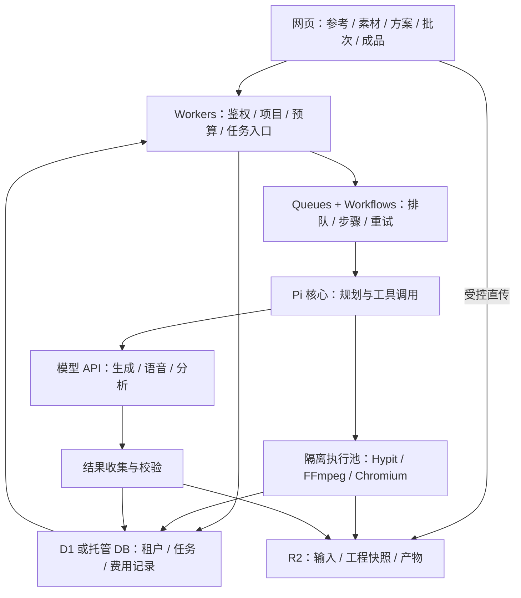

# Pi + Hypit 云端架构调研

调研日期：2026-10-19。范围：负责人提出的个人云电脑、共享工具两条路线；Hypit 官方云化；本仓库迁移 Cloudflare 的实际边界。结论来自公开一手文档、当前源码和小规模打包探测，不代表已部署、已接通付费模型或完成真实成片。

## 最新问题：重写为纯 Workers，而非把原执行层放入容器

用户进一步要求评估：自行改造 Pi/Hypit，或只借鉴 Hypit 架构，以普通 Workers 实现官方视频复刻能力。后文容器方案是此前提出的备选，不是已经采纳的决定，也不应再被当作这一问题的默认答案。

目前判断：Agent、工程描述、依赖调度、模型 API、结果复用与版本管理适合做 Worker 原生实现；完整媒体执行不能仅根据原代码使用子进程判为绝对不可重写。真正待验证的是解码、画面合成、字幕烧录、混音、编码的资源与性能。模型按 API 调用与媒体后处理放在何处必须分开说明。

- [Workers 支持 WebAssembly，但不支持其多线程执行](https://developers.cloudflare.com/workers/runtime-apis/webassembly/)；[每 isolate 128 MB 内存包含 Wasm 分配，付费 CPU 上限可配置至 5 分钟](https://developers.cloudflare.com/workers/platform/limits/)。切片、多次调用可以分担任务，不会消除总计算量，单次工作集仍须受限。
- [ffmpeg.wasm](https://ffmpegwasm.netlify.app/docs/overview/)主要面向浏览器，封装默认使用浏览器 Web Worker；不能将同名概念当作 Cloudflare 兼容证明。定制单线程、精简 codec、流式 I/O 是可研究方向，尚未在本项目验证。
- 严格只用普通 Worker 做媒体处理时，可先试同编码参数、合法关键帧边界下的切片/重新封装；多层画面、烧录字幕和混音通常需要实际处理媒体数据。不能将播放时外挂字幕当作下载 MP4 已烧录字幕。
- 如果允许 Cloudflare 配套托管服务，[Media Transformations 的 Worker binding](https://developers.cloudflare.com/stream/transform-videos/bindings/)已提供抽帧、提取音频、片段输出、裁剪和缩放。这能减少自建执行代码，但属于调用托管媒体计算，不是全部计算发生在普通 Worker 内。本轮公开接口未确认完整多轨时间线、任意动效和混音能力。
- 目前可以支持的结论是“Worker 原生复刻引擎值得做限定范围实验”，不能提前承诺与 Hypit 官方全功能等价。优先验证真实 Worker 上的片段封装、字幕/音频合成以及代表性 720p 短片的内存、CPU、输出正确性与成本，再决定完整改造范围。没有执行这些新实验。

## 1. 历史备选建议与依据

建议采用 **共享生产服务：Workers 负责业务和调度，模型能力调用远程 API，Hypit 的本地执行能力放入按需启动的隔离容器**。用户拥有长期保存的项目空间，计算资源按任务分配，不必一人长期占用一台服务器。

这是工程选型建议，并非已经验证的生产架构。先完成一条真实成片，再决定迁移多少 Pi/Hypit 代码进入普通 Worker。首轮无需大改整个 Hypit。

- 负责人的“共享工具”方向符合批量视频复刻 SaaS；MCP 可以作为工具接入协议，首版内部 HTTP 接口也足够。
- Hypit 官网确实有云端产品，公开入口连接 AgentSky；其计费仍包含云工作区运行时间，不能推断它已把完整制作引擎放进普通 Worker。
- Cloudflare 平台同时提供 Workers 和 Containers。可以把两类运行环境放在同一平台，不必把“用 Cloudflare”和“不用容器”绑定。
- 当前仓库的 SaaS 仍主要完成创作准备：有账号、私有项目、素材和批次；没有接通完整生成、渲染及成品归档。这次调研不改变这个状态。

## 2. Hypit 官方到底怎样云化

### 已确认的公开事实

1. [Hypit 官网](https://hypit.ai/) 的 Open Web App 指向 [Hypit × AgentSky](https://hypit.ai/lab/agentsky/?new=1)。本轮只查阅公开页面，没有登录、购买或创建云会话。
2. [官方计费页](https://hypit.ai/commercial/pricing/) 将 Agent 模型使用、图片/视频生成、云工作区分开计费。工作区会话运行时，包括空闲等待及打开 Studio 的时间，仍收费；结束会话才能停止该部分费用。
3. [AgentSky 开发者 API](https://agentsky.dev/developers) 提供 Agent 配置、会话、事件和流式读取接口，支持 Pi。会话对应持久云电脑，计算费用与模型 token 分开。它是一条可进一步验证的托管执行路线。
4. [Hypit HTTP API](https://hypit.ai/api-reference/) 公开了模型、文本、图像、视频、音频、异步任务和资产接口。本轮没有在公开端点列表中确认“提交完整 Hypit 工程并完成编译、合成、交付”的通用构建 API。

因此要分清：**生成一段模型视频、运行 Agent 云工作区、构建完整视频工程，是三种能力。** 接入 `/v1/videos` 并不自动获得工程编译、字幕、音画合成、浏览器画面渲染和整片导出的闭环。

可借鉴的部分是“网页入口 + 持久项目 + 远程 Agent 执行 + 模型服务”，而不是直接推断其内部用的是 Cloudflare Workers。官方页面没有披露足够细节，不能确认它的底层调度、容器集群或生产可靠性。

### 上游已经提供的拆分边界

[Hypit Providers 文档](https://raw.githubusercontent.com/hypit-ai/hypit/main/docs/guide/providers.md) 区分 Model、Provider、Endpoint，并将远程媒体任务分为提交、轮询、收集结果三个动作；提交后保存远程任务 ID，收集阶段通过资源接口保存文件。

这意味着我们的主要工作可以集中在业务调度、存储适配和执行边界，不必从零重写模型调用体系。需要注意这份文档属于当前上游，不能照抄接口名到本仓库的旧版本。

## 3. 两个思路与适合我们的第三种组合

| 路线 | 计算资源如何使用 | 优点 | 代价与适用性 |
| --- | --- | --- | --- |
| 每人一个长期个人云工作区 | 用户拥有持久环境，需要明确暂停/结束机制 | 支持任意工具、连续交互编辑、保留环境 | 空闲和环境维护成本较明显；适合高级交互工作室，首版批量 SaaS 没有必要默认采用 |
| 普通 Workers + 全部工具远程 API | Agent/业务发起远程任务，供应商执行媒体处理 | 自己管理的运行环境少 | 必须找到覆盖整条链路的 API；受供应商价格、配额、回收结果能力约束；仍需大量适配 |
| **Workers + 按需隔离执行池** | 多租户共用容量，任务使用独立执行环境 | 保留 Hypit 的本地能力，按实际制作占用资源，可控制版本 | 需要构建镜像、调度、隔离、超时和失败恢复；推荐作为自有实现主线 |
| Workers + AgentSky 等托管执行 | 由外部平台启动 Agent 会话 | 有机会最快验证完整 Pi/Hypit 链路 | 要确认自定义源码、依赖、文件交付、费用和转售授权；作为 P0 对照路线 |

“共享”是共享工具服务和资源容量，不是共享用户目录、密钥或运行中的进程。即使每个用户都有逻辑工作区，也可以只在制作时分配执行环境。

[MCP 是客户端/服务端的能力通信协议](https://modelcontextprotocol.io/docs/learn/architecture)。把 FFmpeg 包装成 MCP tool 后，FFmpeg 仍需在某处运行；协议本身不提供渲染算力、排队、公平性或租户隔离。首版只供本产品使用时，先稳定内部任务接口，再按接入需要增加 MCP 外层。

## 4. 当前仓库哪些部分能进入普通 Worker

审计基线：Pi 1.1.0，`abe508e1b89912adde45528136c3221eb69acdd7`；Hypit 0.2.13，`78d7436071bace1ee2bc9bf662d0b89cc3d84e2f`。来源见 `vendor/pi/PROVENANCE.md`、`vendor/hypit/PROVENANCE.md`。

| 本地模块 | 已观察到的依赖/行为 | 迁移判断 |
| --- | --- | --- |
| `vendor/pi/packages/agent/src/agent-loop.ts` | 消息与工具循环，可传入 `streamFn` | 有较好的迁移基础；需验证模型传输、工具校验、中断、状态恢复 |
| `workers/agent/rpc.mjs` | `spawn` 启动 Pi CLI | 不能照搬到普通 Worker；改为核心库调用或远程执行客户端 |
| `workers/agent/workspace-tools.mjs`、`manager.mjs` | 本地目录及状态文件 | 替换成受租户约束的对象存储/数据库工具；Shell 工具转执行服务 |
| `vendor/hypit/packages/protocol` | 协议类型与值处理 | 独立打包通过；仅说明这部分依赖边界较轻 |
| `vendor/hypit/packages/compiler-node` | 本轮打包显露 `node:crypto`；编译通过 Workspace 接口取输入 | 值得单独验证；名字含 node 不构成不能迁移的证据，完整工程编译仍未验证 |
| `vendor/hypit/packages/media-execution/src/execute.ts` | 子进程、临时文件、FFmpeg/FFprobe | 放容器/外部执行服务；已有 artifact/environment 接口可接存储 |
| `vendor/hypit/packages/browser-capture` | Puppeteer、浏览器程序、sharp | 本地实现放容器；若换云浏览器，需要另做接口与帧输出适配 |
| `vendor/hypit/packages/runtime-local` | SQLite、本地配置、进程管理、执行状态 | 不宜整体移植；初期留容器，外部存任务快照与交付物 |
| `packages/hypit-adapter/index.mjs` | 通过子进程调用 Hypit | Worker 侧新增远程 adapter；原 adapter 可在容器内部复用 |
| `packages/saas/store.mjs` | `node:sqlite` 的 `DatabaseSync` 和磁盘数据库 | 迁移到 D1 或托管数据库，并重做异步存储接口与迁移脚本 |
| `packages/remix/index.mjs`、`apps/saas-api/server.mjs` | 本地媒体/JSON、Node HTTP 入口 | 业务模型复用，媒体接 R2、元数据接 DB，HTTP 入口适配 Worker |

目录 `workers/agent` 中的 worker 是本项目后台进程命名，不表示它已经是 Cloudflare Worker。

### Cloudflare 的准确限制

- [Node 兼容表](https://developers.cloudflare.com/workers/runtime-apis/nodejs/) 明确区分真正支持与导入占位：`node:child_process`、`node:sqlite` 等并不提供可用的对应系统能力；`node:crypto` 有支持。能 import 不代表能执行。
- [Workers 的 fs](https://developers.cloudflare.com/workers/runtime-apis/nodejs/fs/) 已有内存虚拟文件系统。因此“Workers 完全没有 fs”不准确，但它不能充当持久视频工作盘，临时文件还占用内存。
- [普通 Worker 的运行限制](https://developers.cloudflare.com/workers/platform/limits/) 包括每 isolate 128 MB 内存；付费 CPU 时间可配置到 5 分钟。网络等待与 CPU 时间不同，也不能据此把一次 HTTP 请求当可靠长任务系统。
- [Containers](https://developers.cloudflare.com/containers/) 提供 Linux 执行环境，可运行所需系统程序；[Sandbox](https://developers.cloudflare.com/sandbox/concepts/) 可以在其上提供隔离执行接口。使用它们仍需验证 Hypit 镜像、资源上限、冷启动、恢复和归档。

### 本轮实际打包探测

使用已有 esbuild 0.28.2，ESM/browser 目标，入口指向本地源码，未安装新依赖；缓存与脚本保存在 `G:/DevCache/Temp/pi-agent-hypite/cloud-research-2026-10-19/`。

| 入口 | 结果 | 应如何理解 |
| --- | --- | --- |
| Pi Agent 核心源码 | 426,913 字节，打包通过 | 不是 Workers 实际运行或模型调用验证 |
| Hypit protocol 源码 | 4,471 字节，打包通过 | 不是完整 Hypit 运行成功 |
| Hypit compiler-node 源码，纯浏览器设置 | 因 `node:crypto` 无法解析而失败 | 浏览器与 Workers 的兼容能力不同，不能据此判定 Workers 不可行 |
| 同一 compiler-node，保留 `node:crypto` 外部引用 | 115,017 字节，打包通过 | 仍需真实编译输入、Workspace adapter 和 Worker 运行验证 |

探测脚本：`bundle-probe.cjs`；完整结果：`bundle-results.json`。这两份本地证据是可重新生成的缓存，不作为生产代码纳入仓库。

补充检查了 Pi 工具校验依赖的 TypeBox 1.3.27：有动态校验器编译，也有不能动态执行时的解释回退，不能仅因出现 `Function` 就断言不兼容。Workers 的[启动阶段动态执行标志](https://developers.cloudflare.com/workers/configuration/compatibility-flags/#enable-eval-during-startup)与[请求时运行限制](https://developers.cloudflare.com/workers/runtime-apis/web-standards/)有区别，P0 应覆盖真实工具 schema 校验及错误参数路径。

## 5. 推荐目标架构

以下为待实施设计；Pi 放入 Worker 的部分须通过兼容性验证。

实施时可以先把 Pi 与 Hypit 一起放进任务容器，保留现有 CLI 行为，以便尽早验证真实视频；同时单独完成 Pi Worker 小实验。二者不是必须同时切换的上线前置条件。

关键运行约定：

1. 上传大文件走受控对象存储直传，业务 API 只传元数据和授权信息；不把整个视频读进 Worker 内存。
2. 持久任务 ID 贯穿项目、批次、模型请求和产物；浏览器断开不丢任务。
3. Pi 的长工具调用要变成可恢复步骤。不能直接把内存中的 Agent 循环包进 Workflows 就认为获得了持久化，需要保存对话、工具调用 ID、外部任务 ID 和步骤结果。
4. 排队和轮询放在持久调度层；采用 [Workflows 的等待与重试](https://developers.cloudflare.com/workflows/build/sleeping-and-retrying/)，避免为模型等待长期占用媒体容器。首个兼容性验证容器可以保持运行；拆分等待是后续成本优化。
5. 容器只拿本任务需要的素材授权；执行任意生成代码时使用任务/租户隔离，不在同一进程混跑不可信工程。运行终止前回传快照，产物持久化后才标记完成。
6. 页面区分准备、排队、分析、生成、合成、归档、失败等真实状态；不靠定时进度条制造成功。

## 6. 并发和成本要按生产链路计算

用户数、登录账号数、API 请求数、同时生成数、同时渲染数是不同指标。200 个账号不等于 200 台机器，也不保证只需一个 Worker 就能同时做出 200 条视频。

需要分别设置租户活跃任务限额、模型供应商并发、媒体执行槽位、结果下载容量和单批次预算。供应商限额是全局共享资源时，使用持久配额协调，不能只在一个 Worker 实例的内存里计数。

[Hypit 异步任务文档](https://hypit.ai/api-reference/jobs/) 给出了接入时必须处理的行为：一个账号所有 key/会话合计最多 64 个排队或运行中的媒体任务；创建请求支持幂等键；目前没有客户 webhook 或取消端点，需要轮询；签名资产 URL 有效期 15 分钟。因此要保存供应商任务 ID，重试复用稳定幂等键，及时将结果转存到自己的 R2。页面“停止后续制作”不能承诺已经提交的模型任务会停止或退款。

队列可以控制分发速度，但“队列消费者并发”不等于“外部模型正在运行的任务数”：提交完毕后消费者可能已经结束，远程任务仍在运行。应单独持有配额租约并在终态释放。[Cloudflare Queues 并发文档](https://developers.cloudflare.com/queues/configuration/consumer-concurrency/)也允许针对上游限制设置消费上限。

总费用应按以下组成核算：模型 tokens + 生成秒数/图片数 + 执行计算 + 存储/流量 + 编排/日志 + 商业授权。共享执行池减少空闲资源，不消除模型和媒体计算费用。

[Cloudflare Containers 计费](https://developers.cloudflare.com/containers/platform/pricing/)按活跃期间的资源计算，CPU 看实际使用，内存和磁盘看所分配规格；休眠后停止该部分计算收费，Workers、Durable Objects、流量等另计。不要只按“CPU 没在忙”判断没有费用。

当前没有代表性真实素材、选定模型与性能测量，因此不提供“单片几分钱”“一天几千条”等报价或吞吐承诺。首轮记录每阶段耗时、峰值内存、生成费用、失败率和冷启动时间后，再给容量/成本表。

## 7. 版本与商业授权

本仓库 Hypit 为 0.2.13；调研时上游 [main/package.json](https://raw.githubusercontent.com/hypit-ai/hypit/main/package.json) 标注 0.3.1。这不是本仓库已升级，也不是对最新稳定发布的认证。[0.3 迁移文档](https://raw.githubusercontent.com/hypit-ai/hypit/main/migrations/0.3.md)及 [0.3.1 迁移文档](https://github.com/hypit-ai/hypit/blob/main/migrations/0.3.1.md)涉及 SDK 与模块边界变化。应先比较可复用接口，再决定保持 0.2.13 做 P0，或建立受控升级分支；不能直接覆盖 vendor。

当前本地与[上游 LICENSE](https://raw.githubusercontent.com/hypit-ai/hypit/main/LICENSE)均为带附加条件的 Apache 许可：使用其源码或衍生代码向外部提供多租户托管/SaaS，需要 Hypit.AI 书面授权。内部制作与向外部开放工作区的条件不同。我们的目标产品直接涉及这条限制，应在公开提供能力前落实；输出视频的归属不能代替代码的 SaaS 授权。

改为容器、MCP 或 AgentSky 不会自动扩大源码许可。若购买官方托管能力，要另行确认 API 商业集成是否覆盖我们的多租户、计费与分发方式，不能从“有 API”推断已获得转售权。

## 8. 可执行验证顺序

| 顺序 | 目标 / 文件或模块 | 验证方式 | 真实风险 |
| --- | --- | --- | --- |
| P0-A | 明确 Hypit SaaS 授权、托管 API 范围；记录于本调研后续决策 | 取得授权范围、价格、配额和交付接口的书面答复 | 许可或托管范围不覆盖我们的产品 |
| P0-B | 新增独立 `experiments/pi-worker`，引用本地 Pi core；不替换线上入口 | 在 workerd/目标 Worker 运行工具调用、参数失败、流式输出、中断、恢复；受控模型实测另计预算 | 打包通过但运行失败；重试重复工具副作用 |
| P0-C | `deploy/saas` 下制作执行镜像，复用 `packages/hypit-adapter` | 用自有/合成样本执行 check、plan 和含真实合成的 build，校验输出时长、画面、音轨、日志及哈希 | 浏览器/FFmpeg依赖、字体、临时盘、资源上限 |
| P0-D | 以 AgentSky 作为可选对照执行后端 | 确认可安装指定 Hypit 源码版本、导入工程、取回文件、停止会话；再与自有容器对比 | 会话能力、价格或授权不适合托管产品 |
| P1 | `packages/saas`、`packages/remix`、新 Worker 入口与存储 adapter | DB/R2 迁移；两租户上传、鉴权、隔离、回滚验证 | 同步 SQLite 调用不能直接换成异步远程 DB；文件路径权限需重做 |
| P2 | `workers/agent` 远程工具、生产调度和产物 adapter | 参考导入→方案→真实单任务→归档→刷新后仍可播放；重试不重复提交供应商 | 状态丢失、重复扣费、过期下载 URL、半成品误报 |
| P3 | 配额、批次调度、故障恢复与费用记录 | 依次做 1/5/20 活跃任务测试，观察内存、供应商配额、排队公平性、断点恢复 | 测试并发会产生实际费用；达到资源上限时要降速 |

P0-B 与 P0-C 是两个边界实验，按项目约定顺序执行，不默认增加代理。本轮没有执行这些付费或部署步骤。需要模型/供应商账号的部分待确定素材、模型和预算；基础镜像与无付费模型的样本合成可先做。

P0 的目标是回答“哪一段在哪里确实可运行”，P2 才是验证用户能够得到完整成片。不能用前者替代后者。

## 9. 与负责人/供应商核对的具体问题

1. 目标是固定复刻流程，还是让用户任意写代码、装工具、连续编辑？前者优先任务执行池，后者才需要长期交互工作区。
2. 官方能否提供整个 Hypit 工程的远程 build API，还是只提供生成模型 API/AgentSky 会话？工程上传、产物清单、事件、失败恢复如何交付？
3. 购买哪种授权可在自有 SaaS 中给多个外部客户提供 Hypit 能力？自托管与官方 API 的范围、费用是否不同？
4. 能否使用我们修改的 Pi/Hypit 源码，固定版本及系统依赖？可否在 AgentSky 上自动启动、结束会话并导出全部项目文件？
5. 共享供应商账号的并发和预算上限是多少？是否需要企业额度、租户分账或用户自带 key？

这些是待确认事项，本轮未联系负责人或供应商，也未注册、充值、创建付费实例或迁移生产服务。
