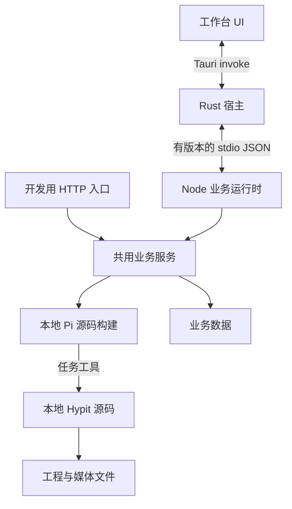

# Pi × Hypit 桌面架构与实施规划

日期：2026-10-18。状态：P1a 核心流程在本机验收通过，当前优先推进批量生产业务，P1b 后续进行。首个目标平台：Windows x64；其他平台未验收前不承诺支持。

## 目标与第一条验收流程

把现有源码工作台变成可安装的本地制作产品。用户安装后无需 Node、npm、Rust 开发环境，即可创建任务、启动真实 Pi 接入检查、检查本地 Hypit 工程；退出和重启后记录仍在。随后接通参考改编、生成、预览、修改和交付。

素材和模型/视频 API 尚未具备，不妨碍架构、桌面宿主与工程管理；不以启动成功替代视频生产验收。

## 架构决策

| 层 | 模块 | 权威职责 |
|---|---|---|
| 界面 | apps/web，后续 React + TypeScript | 页面、共享组件、主题、交互状态和业务状态投影 |
| 桌面宿主 | apps/desktop/src-tauri | 窗口、应用目录、运行时启动、进程树所有权与退出 |
| 业务入口 | packages/application | 共用任务操作、错误、写入顺序、Agent 管理；供 HTTP 与桌面调用 |
| 制作运行时 | apps/runtime | Node stdio 请求/响应，执行上述业务入口；不开放任意 shell |
| Agent 基座 | vendor/pi | 模型、会话、工具调用，保留可修改源码 |
| 制作引擎 | vendor/hypit | 工程检查、生成、Build、渲染与 Studio，保留可修改源码 |
| 存储 | packages/jobs，后续 packages/storage | Node 作为业务写入者；SQLite 管理索引/状态，媒体与工程保存在文件系统 |

Rust 不重写 Pi/Hypit，也不另存一份任务业务状态。初期一个 Rust crate；先复用当前 UI 验证桌面链路，再迁移 React，避免同时改变执行和展示两条链路。

## 执行阶段与验收门槛

| 阶段 | 目标与文件/模块 | 执行顺序 | 验证与完成条件 |
|---|---|---|---|
| P1a 宿主原型（现在执行） | apps/desktop、apps/runtime、packages/application、apps/web/api.js | 抽共用业务入口 → stdio → Rust 子进程管理 → 复用当前 UI → 编译与连接测试 | Rust 可构建；真实 Node/Pi/Hypit 连通；创建/读取任务；无效请求被拒绝；退出清理；原 Web 回归通过 |
| P1b 自包含分发 | scripts/package-runtime、桌面资源清单、release | 打包 Node 可执行文件与本地引擎产物/依赖 → 校验资源 → 安装包 | 在无开发工具的 Windows 环境安装、检查工程、重启保留数据；不能依赖源码目录、全局 PATH 或软链接原目标 |
| P2 契约与持久化 | packages/contracts、storage、application | 定义 task/session/build/event ID → 错误与状态机 → SQLite 迁移 → 有游标事件流 | 请求幂等、取消确认、断线恢复、迁移回滚/备份、单写入者测试；不损坏现有任务 |
| P3 React 工作台 | apps/web/src/app、modules、components、state、api | 共用控件/主题 → 任务与会话 → 工程/素材 → 预览 | 不回退既有编辑保护；加载/失败/空状态、键盘、主题、长列表与真实桌面 UI 验收 |
| P4 制作闭环 | workers/agent、hypit-adapter、工程浏览/预览 | 会话续接 → 工程编辑 → 本地 Build/预览 → 有 API 后生成 → 修改与变体 → 导出 | 从真实 Brief 到产物；失败、取消、重启、费用来源与验收分开记录；不自动重试付费提交 |
| P5 发布 | 签名/更新、备份、平台测试与说明 | 锁版本 → 构建 → 安装/升级 → 发布 | 干净机器、旧数据升级、更新失败恢复；取得适用分发许可，不把开发构建当商业发行版 |

P1a 完成不代表 P1b 完成；开发环境启动不能证明其他电脑可用。阶段状态须附实际命令、结果与未验证项。

## 契约和生命周期

- v1 stdio 每行一个 JSON，请求带 id、method、route、body；返回保留同一 id、状态码、data/error。stdout 只传协议，诊断走 stderr。限制帧大小、并发数、等待时长；未知路由明确失败。
- P1a 实际封包为 `{protocol:1,id,route,method,body}` → `{protocol:1,id,status,data}`；启动发送 `event:ready`，退出命令为 `command:shutdown`。请求上限 64 KiB，宿主响应帧上限 8 MiB，Node 最多接收 32 个在途请求；Rust 当前串行交换，每次最多等待 60 秒。超时不自动重试写操作，长任务启动与状态查询分开。退出优先等待 3 秒，随后回收 Windows Job Object。
- AgentRun、视频 Build 与最终交付是不同身份和状态。启动返回任务 ID；取消请求已接收不等于子进程已停止。
- 窗口隐藏只停止 UI 订阅；P1 主窗口关闭触发退出，不后台偷偷继续制作。退出先拒绝新请求、请求 Node 清理，超时再回收进程树。
- Windows 宿主通过 Job Object 管理 Node 及其子进程；宿主崩溃/退出也应收回任务进程。Rust 不接受前端传入任意可执行路径。
- 重启时从持久记录恢复展示，未完成运行标记中断，不自动重试模型/生成请求。
- 初期桌面独立数据目录与原 4317 Web 数据分开，避免两个管理器同时写同一任务；P2 再实现明确的跨进程所有权/迁移。

## 真实风险与处置

1. Hypit 动态 TypeScript 加载、Pi 动态扩展和原生依赖使“单 JS 文件”打包不可靠。P1b 必须保留运行资源布局并验证脱离源码目录启动。
2. Node 可执行文件、原生库、浏览器/媒体工具和 Python 服务需要平台匹配；先证明 Windows 核心路径，其他能力按需提供明确安装/禁用状态。
3. 只杀 Node 主进程可能遗留 Pi/渲染进程；需真实进程树清理测试，不能只检查 Promise 结束。
4. SQLite 与现有 JSON 数据迁移必须先备份并验证，不直接覆盖用户记录。
5. 文档指导架构方法，不直接复制 ORG2 的实现。Hypit 原许可证与商业分发限制持续适用。
6. 本机编译缓存放 G:/DevCache/CargoTarget，Cargo 下载缓存、npm 与临时文件均在 G 盘。终端用户数据目录按操作系统解析，不要求用户有 G 盘。
7. P1a 暂不支持多个桌面实例同时访问同一数据目录；打包后的目录解析、原生导出与强制崩溃恢复需要后续专项验收。原生窗口未保存拦截与核心 WebView 交互已完成本机验收。

## 本轮任务清单

- [x] 架构规划与验收门槛落盘。
- [x] 共用业务入口 + stdio 协议。
- [x] Tauri 最小宿主 + Windows 进程树管理。
- [x] 同一 UI 通过桌面 IPC 调用真实业务：原生 WebView 创建/编辑/检查/会话/重启恢复已验收。
- [x] 自动测试、构建与运行证据（见 verification.md、desktop-qa.md；不含安装包验收）。
- [ ] 自包含安装包与无开发环境验收（P1b）。

执行结果：`npm test` 14/14；`desktop:check` 通过；`desktop:test` 1/1（Windows 实际进程树）；`desktop:smoke` 退出码 0。追加真实 WebView 验收通过，覆盖任务创建/修改/复制、Pi 接入与停止、Hypit check/plan、关闭保护、重启恢复、主题与小窗口。P1a 核心范围完成；业务优先级已调整为账号/批次、素材复用和生产队列；P1b 的资源清单与自包含运行包后续继续，不能沿用开发环境路径冒充安装版。

参考：用户 Obsidian《桌面端产品的技术架构》；[Tauri 命令](https://v2.tauri.app/develop/calling-rust/)；[Sidecar 分发](https://v2.tauri.app/develop/sidecar/)。版本以项目锁文件与实际构建为准。
