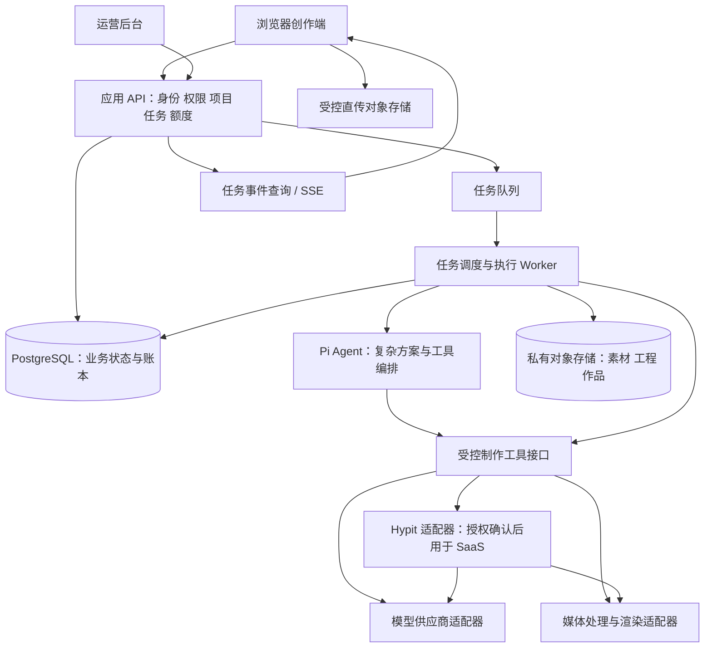

# Web SaaS 转型规划

日期：2026-10-18。状态：项目规划，尚未实施 SaaS 迁移或云端部署。

## 1. 产品定位与转型决定

目标：面向创作者、电商和内容运营用户的 AI 创作 SaaS。用户在网页上传素材、选择创作方式、提交任务、查看作品和消费额度；Pi Agent 与 Hypit 等执行组件部署在服务器内部，不要求用户安装或理解这些工具。

产品形态参考 Pollo 的创作平台组织方式，以“参考视频改编 + 多版本批量制作”作为首个重点能力，逐步加入图片与视频的基础生成。此前的 200 账号不是业务门槛；账号矩阵是可选应用场景。桌面壳保留为开发/内部工具，停止作为首要交付方向。

### 对标证据与使用边界

本轮检查了 Pollo 公开页面，未登录、购买或执行生成：

- [首页](https://pollo.ai/zh/home)：视频、图片、智能体入口与创作推荐。
- [产品目录](https://pollo.ai/zh)：按创作任务组织生成、编辑与营销工具。
- [Recast](https://pollo.ai/zh/recast)：围绕参考视频中的人物、产品、场景改编组织入口。

以上支持产品组织参考，不能证明其生成质量、成本或内部技术架构。本项目不假设 Pollo 使用 Pi/Hypit，也不复制其品牌、素材或全部工具目录。以下结构与优先级是针对本项目的建议。

## 2. 首版范围

首版应完成一个可收费、可追踪的真实创作闭环，再扩展能力目录。建议以“参考改编”建立差异化，基础生成作为共享能力逐步接入。具体换物、换人、动作保留效果必须由供应商小样验证，不承诺任意视频精准替换。

### 用户端模块

| 模块 | 细分功能 | 页面呈现 | 首版范围 |
| --- | --- | --- | --- |
| 公开网站 | 产品说明、真实案例、能力边界、套餐、登录 | 品牌首页 + 用途落地页 | 首页、真实案例、明确套餐规则；没有案例时不伪造 |
| 创作首页 | 选择创作类型、最近项目、模板入口 | 任务入口 + 作品缩略图，减少工程术语 | 首先开放已验证的参考改编入口 |
| 参考改编 | 上传参考、替换素材、表达修改意图、核对方案 | 参考预览 + 替换卡片 + 结果区 | 先支持一种验收通过的改编方式；手工修正方案 |
| 批量制作 | 新建批次、逐条素材组合、共用与覆盖参数、数量核对 | 变体矩阵 + 小样试制 + 批次详情 | 明确组合，不自动展开全部排列；限制批量规模 |
| 基础图片/视频生成 | 提示词、参考素材、模型与参数、数量、估算 | 集中的生成面板 + 历史结果 | 在供应商验收后增量开放；不铺未实现按钮 |
| 素材库 | 上传、预览、分类、关联项目、空间用量、删除 | 媒体网格 + 详情 | 私有素材；大小/格式限制；删除与引用规则 |
| 我的作品 | 项目/批次/状态筛选、播放、版本、重新制作、下载 | 作品网格 + 播放详情 + 来源记录 | 真实文件落盘后才进入作品库；不默认公开 |
| 任务中心 | 排队、进行中、等待输入、失败、取消请求、待核实 | 简明阶段与可操作错误 | 可离开页面，重新登录仍能找回；不暴露原始堆栈 |
| 账户与额度 | 注册登录、订单、套餐、额度余额、扣费明细 | 账户设置 + 用量账本 | 用户私有空间、配额；支付在真实生产跑通后接入 |
| 帮助与反馈 | 输入要求、结果问题反馈、任务编号 | 上下文帮助 | 结果质量与执行失败分别反馈 |

首版暂缓：公开社区、模板交易市场、团队协作权限、自动发布平台、分销体系、全量模型集合、移动 App、自建视频基础模型。

### 运营后台

独立管理入口，权限与用户创作端隔离。包含用户/空间状态、任务排查、供应商健康与配额、模型能力开关、订单与额度调账、成本对账、举报处理、模板版本和操作审计。调账必须有原因、操作者和关联记录；客服查看用户私有内容需受控和留痕。

## 3. 核心用户路径

登录 → 上传参考与替换素材 → 选择改编方式 → 查看/调整方案 → 核对数量与额度 → 提交小样 → 后台执行 → 作品预览 → 按反馈重做 → 批量扩展 → 下载成品。

需要支持的分支：

- 素材不支持：定位到文件，保留其他上传与输入，说明可接受规格。
- 额度不足：保存草稿，说明所需额度与补充入口。
- 提交超时：查询原请求是否受理，不直接再次扣费提交。
- 部分变体失败：成功作品可用，仅针对明确失败项补做。
- 用户离开：任务继续运行；重进能看到当前状态。
- 结果不满意：创建新版本并说明新增费用，原作品保留。
- 供应商无法确认：显示待核实，不直接标成失败并退款后重发。

## 4. 总体架构

### 各层职责

| 层 | 负责 | 不负责 |
| --- | --- | --- |
| Web 创作端 | 输入、预览、方案确认、任务和作品体验 | 保存供应商密钥、直接操作服务器路径、最终扣费 |
| SaaS 业务层 | 用户与空间、权限、配额、状态、订单、作品归属 | 在 HTTP 请求中长时间运行视频生成 |
| 调度层 | 持久任务、并发限制、租户公平性、重试、恢复 | 把模型回复当作完成依据 |
| Pi Agent | 理解创作意图、提出结构化方案、调用受控工具、辅助修改 | 用户鉴权、额度账本、跨租户访问控制 |
| Hypit 适配器 | 使用已验证的工程、生成与渲染能力 | 自动提供所有模型或确保任何参考都能复刻 |
| 供应商适配器 | 能力参数、提交/查询/取消、错误归一、成本来源 | 自行决定产品收费规则 |
| 存储与产物层 | 文件、版本、校验、访问链接、生命周期 | 以临时下载链接作为永久作品身份 |

简单图生视频等确定性任务可以直接调用供应商适配器；复杂参考改编才进入 Pi 编排。Agent 输出先做结构与权限校验，再执行工具。统一结果契约使执行引擎可替换，用户作品不会绑定某个 CLI 的内部路径。

## 5. 技术路线建议

这是待落地选型，不是当前依赖或已经验证的云配置：

- 前端采用 React + TypeScript；公开页面如需 SEO 可用 Next.js，创作端复用同一组件与主题。先迁移一条真实流程，不同时重写全部旧页面。
- Node/TypeScript 模块化业务服务，复用现有领域校验与适配经验；初期不拆大量微服务。
- PostgreSQL 持久化用户、项目、任务、快照和账本；Redis/持久队列承担调度与短期缓存，数据库保存权威任务状态。
- 私有 S3 兼容对象存储承接素材和成品。浏览器使用受限签名直传/分片上传；服务端校验归属、大小、类型与完成状态。替换当前逐片穿过 stdio 的上传方式。
- Linux 容器部署 API 与 Worker，分别扩容。初期使用外部生成 API 和 CPU 媒体处理；只有验证确有自托管推理需求后再购买 GPU。
- 任务状态通过查询及 SSE 更新，断线重连从持久事件继续。媒体通过鉴权后的短期链接访问。
- 开发、测试、生产使用独立数据库、存储桶、供应商凭证与支付环境。首期无需 Kubernetes；实际服务器/地域选定后补部署清单。

具体版本、云厂商和支付渠道在实施前按地域、预算与接口能力验证并锁定；本规划不沿用竞品价格或假定某供应商一定支持目标替换效果。

## 6. 多租户与执行隔离

即使首版每人只有一个工作空间，也建立 User → Membership → Workspace 关系，避免以后重建身份模型。现有“内容账号”另命名为 ContentProfile，不能混用登录账户。

所有 Project、Asset、Job、Batch、Artifact、LedgerEntry 带 workspace_id。服务端从已验证会话取得可访问空间，不信任浏览器提交的空间编号。数据库访问和文件访问都校验归属；公开分享单独授权，默认关闭。

Agent/媒体 Worker 处理用户输入必须隔离：每任务独立工作目录和进程环境，资源/时间限制、最低权限、不挂宿主控制接口、不提供跨任务凭证。用户文件名、提示词、参考中的文字均不作为系统命令或工具授权。网络访问按需要限制，远程素材下载防止访问内网服务。日志和产物清除密钥与内部路径。

当前本地 Host/Origin 检查、固定 dataRoot、共享 Pi home 和令牌媒体端口不构成 SaaS 身份与隔离方案，不能直接开放公网。

## 7. 任务、版本与额度

主要对象：用户、工作空间、项目、素材、方案版本、批次、变体任务、执行尝试、供应商请求、产物版本、订单、额度账本和审计事件。

任务阶段：draft → validating → queued → planning/generating/rendering → succeeded。失败、等待输入、停止请求中、已停止、待核实为独立状态；无需执行的阶段可按任务类型跳过。

成功依据：供应商/渲染记录完成 + 产物已存入受控存储 + 文件校验通过 + 数据库建立作品版本。供应商返回一个临时 URL 或 Agent 回复“完成”均不足够。

扣费建议采用预占、结算、释放账本：

1. 服务端生成报价快照，包含能力、数量、参数和额度规则版本。
2. 提交时以幂等请求在事务内创建任务并预占额度；可靠投递任务事件。
3. Worker 执行前核对额度与任务所有权，保存供应商请求 ID。
4. 成功按约定结算；明确未执行的失败释放额度；部分成功按条目结算。
5. 请求结果未知先对账。取消不保证供应商没有发生费用，取消及返还规则在提交前说明。
6. 支付回调验签、去重、金额/币种核对；浏览器跳转成功不作为入账依据。

用户额度、真实供应商成本、支付收入分别记录，不混成同一个余额。避免 Agent 决定是否扣费。首版测试使用沙箱支付与测试额度；真实生成质量和成本未验证前不承诺“无限生成”。

## 8. 现有代码复用与迁移

| 现有部分 | 去向 | 必须改变什么 |
| --- | --- | --- |
| vendor/pi、workers/agent | 服务端 Agent Worker 的基础 | 会话/凭证/工作目录隔离，Linux 验证，取消与恢复 |
| vendor/hypit、hypit-adapter | 可选制作引擎适配器 | SaaS 授权、能力实测、产物与任务契约 |
| packages/remix | 项目、方案、批次的业务参考 | 文件 JSON → 数据库；存储键代替本地路径；校验租户 |
| packages/bulk、jobs | 批次、幂等、快照和任务校验参考 | 持久队列与数据库事务；不能复用单进程锁作分布式锁 |
| apps/web | 流程与交互原型 | 新创作端组件化；去掉本地工程概念和仅演示能力 |
| apps/api、application | 应用服务分层参考 | 登录、权限、速率限制、上传/账务契约 |
| apps/desktop、runtime | 暂留开发/内部调试 | 不作为外部用户依赖，不优先继续打包 |
| 当前测试 | 回归基线 | 增加跨租户、扣费、重复消息、供应商超时及云文件测试 |

拟新增模块：apps/saas-web、apps/saas-api、apps/admin、workers/production；packages/auth、database、storage、billing、providers、contracts。尽量共享真实领域能力，不在新目录复制一整套失去同步的本地业务代码。

现有本地项目以后通过显式导入任务迁移：指定目标空间、上传媒体、映射 ID、校验哈希与数量、生成报告。保留本地原数据，不在迁移成功前删除，不把测试夹具当真实用户作品。

## 9. 必须先解决的 Hypit 授权条件

已核对本仓库固定提交的 [Hypit LICENSE](https://raw.githubusercontent.com/hypit-ai/hypit/78d7436071bace1ee2bc9bf662d0b89cc3d84e2f/LICENSE)，与 vendor/hypit/LICENSE 对应。其额外条款要求对外托管/多租户 SaaS 取得书面授权；免费外部测试也不能仅因不收费就视为豁免。Pi 本地许可证为 MIT，保留声明。

本项目的部署设想直接涉及上述条件。公开开放 Hypit 能力前，需要拿到适用书面商业授权及范围；若无法取得，执行层改用具备适用授权的供应商/媒体处理实现。引擎可替换设计解决依赖，不改变 Hypit 本身的许可条件。

可先进行 SaaS 产品设计、身份/存储/任务基础设施以及适用范围内的内部验证；不因为授权待定就停止所有开发，也不把本规划当作授权已获得。本轮未联系权利人、未付款、未部署对外服务。

## 10. 实施阶段和验收门槛

| 阶段 | 目标与主要模块 | 执行与验收 | 依赖 |
| --- | --- | --- | --- |
| S0 能力与约束确认 | 引擎授权、供应商、小样、输入输出契约 | 选择一种参考改编能力，用真实样本记录质量、时间、成本、失败情况；明确可宣传范围 | 参考素材、供应商凭证/预算、Hypit 授权路径 |
| S1 SaaS 基础 | saas-web/api、auth、database、storage | 两个测试用户登录；各自上传/预览素材；互猜 ID 和链接无法访问对方资源；刷新重登不丢数据 | 开发/测试环境；与 S0 独立可推进 |
| S2 单条真实制作 | production、providers、Agent/引擎适配 | 上传 → 提交 → 后台执行 → 私有作品 → 下载，浏览器退出仍能继续；重复提交不多执行 | S0 通过、S1、受控预算 |
| S3 付费闭环 | billing、订单、额度、后台 | 沙箱订阅/充值、重复回调、并发预占、失败释放、部分结算、对账通过 | 支付渠道与规则；真实商业上线前完成 |
| S4 批量与版本 | 批次、限流、试制、重做、作品版本 | 一个参考多个变体；部分失败仅补失败；取消/崩溃恢复不重复收费；输出版本可追溯 | S2 和额度规则稳定 |
| S5 小范围上线 | 运营后台、监控、备份、部署回滚 | 明确授权后邀请少量真实用户；恢复数据库/文件、告警、费用限额和回滚演练通过 | 地域、授权、支付、真实质量与成本达标 |
| S6 能力扩展 | 图片、视频、模板和其他模型 | 每项能力有输入契约、真实样例、费用规则和失败路径后开放 | 使用反馈和成本数据 |

这是按验收推进的顺序，不承诺未经评估的工期。S0 与 S1 可交错推进，但本项目当前仍按单代理顺序开发。不先把竞品全目录做成只有表单的页面。

## 11. 成本、运行与待定信息

业务单位成本需包括：规划模型调用、生成、重试、渲染、存储、下载流量和服务开销。价格取决于真实供应商账单与样本分布；本轮不制定虚构售价或毛利率。

上线指标先收集基线：受理成功率、实际作品成功率、排队与生成时间、每份有效作品成本、用户返工率、扣费异常、供应商错误率。成功率的分母、失败类型和统计时段必须明确。

有待用户后续确定、但不阻塞基础设计的关键项：

- 首批用户地域和界面语言：影响服务器、支付及运营要求。
- 首批重点能力：建议参考视频改编/批量变体；精确换物或换人需专项质量验证。
- 供应商与试制预算、目标视频时长/规格。
- Hypit 商业授权是否已有，以及可接受的授权费用。
- 商业模式：建议先“套餐额度 + 补充额度”，最终规则待成本验证。

暂定：单人私有空间起步、中文界面可国际化、外部模型 API、真实作品默认私有、单区域部署。地域与支付未选定，不提前采购云资源。

## 12. 本次交付边界

已完成公开对标页面与本地能力核对、许可证原文核对、产品范围和迁移规划。未实施 SaaS 前后端、用户系统、数据库迁移、支付或部署。既有本地 21 项测试不是 SaaS 可用性证明。

下一开发单元建议为 S1 的“身份 + 私有素材 + 项目”完整切片，并同步推进 S0 的一种真实制作能力验收。后续所有页面必须接入明确的服务与状态，不再以导航数量代表产品进度。
